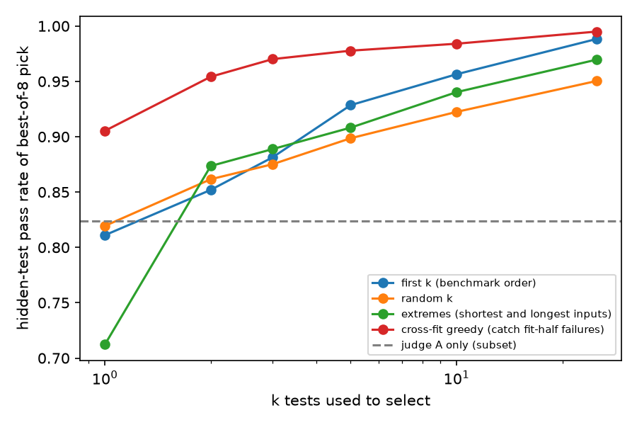

# How few tests does a verifier need? Test-suite reduction for best-of-n selection

When a small set of unit tests is used to pick the best of n code samples, how often does the pick pass the chosen tests but fail the full hidden suite? Which ways of choosing those tests keep that overfitting low? This repo measures it exactly on EvalPlus, which has a median of 111 hidden tests per problem.

**Main results:**

- **One test goes a long way, but leaves real overfitting.** Selecting best-of-8 with 1 random test lifts the pass rate of the pick from 52.3% to 81.9%. Still, 18% of picks pass that test and fail the hidden suite.
- **How tests are chosen matters as much as how many.** Two tests chosen from earlier samples' failures (95.4%) beat 25 random tests (95.0%). At 3 tests the overfit rate is 3.0%, against 12.5% for 3 random tests.
- **Some intuitive choices are worse than random.** Picking the shortest and longest inputs scores 71.2% at k=1, because the shortest input is often a trivial case such as an empty list.
- **One test adds a lot to an LLM judge.** Best-of-8 by a 7B LLM judge alone picks a correct sample 82.4% of the time. Using 1 random test first, with the judge breaking ties, raises that to 90.8%.



## Setup

| | |
|---|---|
| Tasks | EvalPlus MBPP+ and HumanEval+, 527 problems, median 111 hidden tests each |
| Samples | Qwen2.5-Coder-1.5B-Instruct (MLX, 4-bit), 16 per problem, temperature 1.0 |
| Execution | Every sample ran on every hidden test in a macOS sandbox, one pass/fail bit per test, with a 2 s per-test timeout and an 800 MB memory cap |
| Gold | Passes every hidden test |
| Cross-fit design | Samples 0 to 7 of each problem are only used to choose tests. Samples 8 to 15 form the selection pool, so no strategy sees the pool it is scored on. 309 problems have both correct and wrong samples in the pool. |
| Selection | Best-of-n picks the sample passing the most of the k chosen tests, with random tie breaks. Results average 1,000 random subsets per problem (10 test draws for random k). |

Strategies for choosing k tests:
1. **First k.** The benchmark's own order, so the original hand-written tests come first.
2. **Random k.**
3. **Extremes.** Alternate the shortest and longest test input.
4. **Cross-fit greedy.** Pick the test failed by the most still-uncaught wrong samples in the fit half. This needs the full suite run once on a few earlier samples.

## Results

Without selection, a random sample from these pools is correct 52.3% of the time.

**Hidden-test pass rate of the best-of-8 pick:**

| strategy | k=1 | k=2 | k=3 | k=5 | k=10 | k=25 |
|---|---|---|---|---|---|---|
| first k (benchmark order) | 0.811 | 0.852 | 0.881 | 0.929 | 0.956 | 0.988 |
| random k | 0.819 | 0.862 | 0.875 | 0.899 | 0.922 | 0.950 |
| extremes (shortest and longest inputs) | 0.712 | 0.874 | 0.889 | 0.908 | 0.940 | 0.970 |
| cross-fit greedy | 0.905 | 0.954 | 0.970 | 0.978 | 0.984 | 0.995 |

**Overfit rate at n=8** (the pick passes all k chosen tests but fails the hidden suite):

| strategy | k=1 | k=2 | k=3 | k=5 | k=10 | k=25 |
|---|---|---|---|---|---|---|
| first k | 0.189 | 0.148 | 0.119 | 0.071 | 0.044 | 0.012 |
| random k | 0.181 | 0.138 | 0.125 | 0.101 | 0.078 | 0.050 |
| extremes | 0.288 | 0.126 | 0.111 | 0.092 | 0.060 | 0.030 |
| cross-fit greedy | 0.095 | 0.046 | 0.030 | 0.022 | 0.016 | 0.005 |

**A few tests against an LLM judge** (142 problems whose pool was scored by Qwen2.5-7B-Instruct):

| selector | n=1 | n=2 | n=4 | n=8 |
|---|---|---|---|---|
| random | 0.533 | 0.537 | 0.535 | 0.536 |
| LLM judge only | 0.533 | 0.680 | 0.769 | 0.824 |
| 1 random test, judge breaks ties | 0.533 | 0.709 | 0.828 | 0.908 |
| 3 random tests, judge breaks ties | 0.533 | 0.713 | 0.837 | 0.923 |

## Limitations

- One policy model, one temperature and one seed.
- Cross-fit greedy is not free. It needs full-suite results on a few earlier samples of the same problem, which is realistic when a large test pool exists but is too costly to run on every candidate.
- Best-of-n with n ≤ 8 is mild optimization pressure. Training with RL against the same k tests would push much harder.

## Reproduce

```bash
python -m venv .venv && source .venv/bin/activate
pip install -r requirements.txt

python scripts/04_analyze.py   # recompute the tables and figure from the released data
bash reproduce.sh              # or rerun everything from scratch (Apple-silicon Mac, about 2 h)
```

## Layout

```
harness/   shared code: problem loading, sandboxed per-test execution, LLM judge, best-of-n simulation
scripts/   00 validate harness, 01 generate, 02 execute, 03 judge, 04 analyze
data/      samples, per-test pass/fail bits, judge scores
results/   tables.md, results.json, k_curve.png
```

## Related work

- J. Liu et al. *Is Your Code Generated by ChatGPT Really Correct?* (EvalPlus). NeurIPS 2023.
- L. Gao, J. Schulman, J. Hilton. *Scaling Laws for Reward Model Overoptimization.* ICML 2023.

Companion projects with the same samples: `judge-gaming-best-of-n` and `metamorphic-testing-of-llm-judges`.

## Citation

```bibtex
@misc{malik2026testreduction,
  author = {Muhammad Ghaus Malik},
  title  = {How Few Tests Does a Verifier Need? Test-Suite Reduction for Best-of-n Selection},
  year   = {2026},
  note   = {Code and data}
}
```
